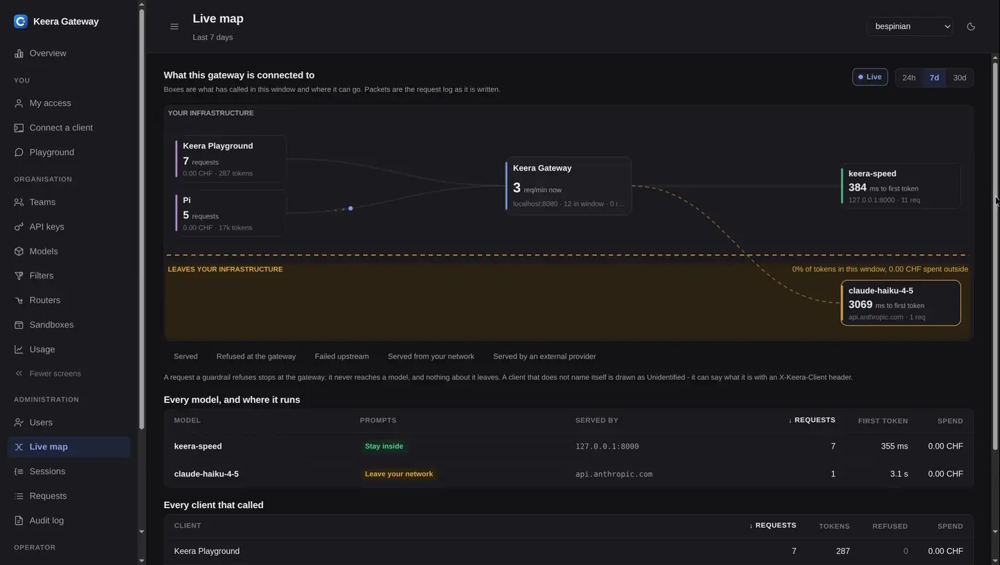

# Keera Gateway - one endpoint for every AI request

[keera.ch](https://keera.ch)

One static Go binary in front of every model you run yourself and every one you
license. You decide who may use which model, and how. It runs in your own
infrastructure or in a Swiss data centre, and nothing leaves that you did not
allow.

The gateway is one half of Keera, the AI stack run in Switzerland. The other
half is **Keera Engine**: open-weight coding models served on vLLM, on your own
GPUs or on Swiss ones.



## What is in this repository

- **Keera Gateway** - the server binary, `cmd/keera-gateway`: guardrails,
  budgets, filters, routers, sandboxes, the control panel and the audit log.
- **Keera CLI** - the `keera` command, `cmd/keera`. It administers a deployment
  and sets up a developer's editor for it. Every
  [release](https://github.com/bespinian/keera-gateway/releases) has it for
  Linux, macOS and Windows.
- **A single-host deployment** - compose files that run the gateway, its
  database, Keera Engine and Keera Decider on one machine. There, Keera Engine
  runs on llama.cpp on the CPU, or on vLLM on a GPU. This is also the
  development loop.

Every tool that calls a model uses the same address. The gateway checks each
request, logs it and passes it on.

```
       Your tools                          Keera Gateway                          Models
┌───────────────────────┐         ┌─────────────────────────────┐         ┌─────────────────────┐
│ Claude Code           │         │ 1  Identify the key, its    │         │ Keera Engine on     │
│ Codex, OpenCode, Pi   │         │    project and organisation │         │ vLLM, on your GPUs  │
│ Internal apps         │  HTTPS  │ 2  Apply guardrails,        │         │ or Swiss ones       │
│ Notebooks and CI jobs │────────▶│    budget, rate limit       │────────▶│                     │
│ any OpenAI client     │         │ 3  Filter secrets and       │         │ Anthropic and other │
└───────────────────────┘         │    personal data out        │         │ providers, opened   │
                                  │ 4  Route to a model the     │         │ by policy           │
                                  │    key may use              │         └─────────────────────┘
                                  └──────────────┬──────────────┘
                                                 │
                                                 ▼
                                Every request into the request log
                                          in Postgres
```

Everything runs on one port, `:8080`, split by path: inference under `/api`,
administration under `/control`, sandbox attach under `/sandbox`, and the
control panel at `/`. See
[docs/gateway.md](docs/gateway.md#one-listener-four-surfaces).

The gateway speaks three APIs, all with the same guardrails, accounting and
audit:

- the OpenAI API: `/api/v1/chat/completions`, `/api/v1/completions` and
  `/api/v1/embeddings`
- the Anthropic Messages API, used by Claude Code: `/api/v1/messages`
- the OpenAI Responses API, used by Codex: `/api/v1/responses`. The gateway
  stores no conversations; see
  [docs/gateway.md](docs/gateway.md#three-request-shapes).

A Messages request to Anthropic, or a Responses request to OpenAI, is forwarded
in its own API, so prompt caching and reasoning keep working. To switch
provider, a client changes one variable.

## Run it

```sh
cd compose
cp .env.example .env    # then set KEERA_OPERATOR_KEY and KEERA_SECRET_KEY
podman compose up -d --build
```

That runs the gateway, Postgres, a CPU model and a decision model on one host.
[compose/README.md](compose/README.md) covers the GPU tier and what the CPU tier
cannot do. [First run](docs/install.md#first-run) issues a first key and sends
a request, and [docs/install.md](docs/install.md) covers every setting.
[docs/run-locally.md](docs/run-locally.md) is the development loop.

`keera doctor` checks the deployment and says what to fix; see
[When it does not work](docs/install.md#when-it-does-not-work).

A developer signs in with one command, which also makes that deployment the
default for later commands
([which gateway a command uses](docs/install.md#the-keera-command)):

```sh
keera login --url https://keera.example.ch
```

`keera connect claude-code` sets Claude Code up in one step. It gives this
machine a key of its own and writes it into `~/.claude/settings.json`, with
every model the key may use
([docs/gateway.md](docs/gateway.md#connecting-claude-code)). For other editors,
`keera connect` prints the configuration to stdout and the instructions to
stderr:

```sh
keera connect claude-code         # Claude Code, ready to run
keera connect                     # the clients this deployment can configure
keera connect opencode --key laptop
```

## What it does

**Guardrails, budgets and rate limits** attach to an organisation, a project or
a key, and a level can narrow what it inherits but never widen it
([the tenancy model](docs/gateway.md#the-tenancy-model)). Clients name an alias
like `keera-speed`, so you can swap the model behind it without developers
changing anything ([the alias](docs/gateway.md#the-alias-is-the-api-contract)).

```sh
keera guardrail set project <project-id> --models keera-speed --rpm 120 --budget 500 --period month
keera guardrail effective key <key-id>   # and what holds this one key
keera usage --by project
```

**Filters** check what is _in_ a request before it is forwarded: a small model
removes credentials or client names, or refuses the request, and a list of
regular expressions catches anything with a fixed shape, such as an API key or
an IBAN. A new filter starts in shadow, so you can measure it on a week of real
traffic before it enforces. [docs/filters.md](docs/filters.md)

**Routers** change where a request goes: small tasks to the local model and
heavy reasoning to a large one, or to the next model when one is down. A client
names a router where it would name a model. [docs/routers.md](docs/routers.md)

**Sandboxes** are developer machines inside the cluster, each with the
toolchain, its own API key and an expiry. An agent's sandbox does one task and
ends by pushing a branch, and where egress is limited, that branch is all that
leaves it. [docs/sandboxes.md](docs/sandboxes.md)

**MCP servers** get the same controls as models: an agent calls a server's
tools through `/api/mcp/<alias>` with its Keera key, sees only the tools its
guardrail allows, and every call is filtered and logged.
[docs/mcp.md](docs/mcp.md)

```sh
keera mcp add github --endpoint https://api.githubcopilot.com/mcp/ --api-key @-
keera guardrail set project <project-id> --tools github/search_code
keera mcp calls --summary
```

**Hosted models** get the same allow-lists, budgets, rate limits and audit as
any other model. Prompts sent to them leave your infrastructure, so put a
guardrail on them. [docs/providers.md](docs/providers.md)

**Claude subscriptions** let a Claude Team or Enterprise plan pay for Claude
Code, while Keera applies the guardrails and shows each person's usage. They
are off unless `KEERA_CLAUDE_SUBSCRIPTIONS` is turned on.
[docs/subscriptions.md](docs/subscriptions.md)

**Billing** lets a deployment hold its own key for a hosted provider. Every
organisation then uses that key, and is billed at the provider's list price:
each month, or in advance by card through PostFinance Checkout.
[docs/billing.md](docs/billing.md)

**The panel** has these screens, among others:

- **Live map** - how much of the traffic leaves your infrastructure.
- **Requests** - the log every other number is counted from.
- **Sessions** - the same log, grouped into tasks.
- **My access** - the developer's own view.

Every project, key, model, user, filter and router has its own screen with the same four
numbers. `keera usage`, `keera failures`, `keera session list`,
`keera filter report` and `keera router report` show the same reports in a
terminal.

## Documentation

The detailed documentation is in the [docs](./docs) directory.

## Contributing

Issues and pull requests are welcome. Read [CONTRIBUTING.md](CONTRIBUTING.md)
first: every pull request must agree to the Contributor Licence Agreement in it.

## Licence

Keera is source-available under the [Keera Community Licence
v1.0](https://github.com/bespinian/keera-gateway/blob/main/LICENSE). Anybody may
read, modify and redistribute the source code. It may be run for personal
non-commercial use, by non-profit organisations, and by anybody for
development, testing, evaluation and research.

Production use by a for-profit or public sector organisation, and running Keera
as a hosted service, need a commercial agreement with
[bespinian GmbH](https://bespinian.io). Get in touch through the
[bespinian contact form](https://bespinian.io/en/contact/#form).
